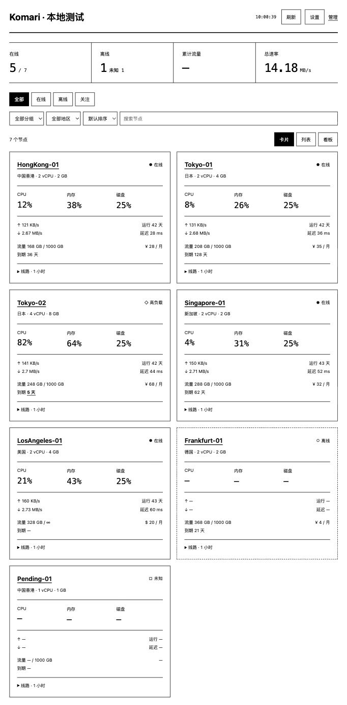

# Komari Ink

黑白极简 Komari 主题。纯 HTML、CSS 和 JavaScript，无运行时第三方依赖。

从 [Releases](https://github.com/ohbaby30/komari-ink/releases/latest) 下载安装包，在 Komari 后台主题管理上传 `Komari-Ink-v1.0.0.zip`，安装后选择 `Komari Ink`。不要上传本源码目录代替 ZIP。切换主题前保留原主题和其安装包。

默认每 60 秒刷新，支持手动、30 秒、60 秒、300 秒。页面在后台时暂停请求，重新打开时刷新。设置及最多 6 条线路的选择仅保存在当前浏览器。

支持卡片、列表、看板、分组/地区筛选、排序、节点详情和按需历史记录。线路统计窗口为 1 小时；历史记录最多 120 条。离线或缺少数据时显示「—」，请求失败保留上次成功快照并提示。

接口基线：Komari 1.6.0 官方源码。实际服务端与设备兼容性须以安装测试为准。主题不提供模拟数据，不修改后端配置；登录和管理通过 Komari 自带后台完成。

仓库外的项目工作目录提供测试、预览和打包工具，不作为主题安装内容。当前源码为本项目实现；未包含第三方框架、字体、图标或图表代码。

## GitHub Actions 发布

将本目录的内容作为仓库根目录上传，包含隐藏目录 `.github/`；不要把外层项目目录整体上传。

修改 `komari-theme.json` 中的 version，提交源码后推送同名版本标签，例如 `v1.0.0`。Actions 自动检查语法、版本匹配及 ZIP 内容，再创建对应 Release，附带 `Komari-Ink-v1.0.0.zip`、`SHA256SUMS` 和 `build-report.json`。下载这个主题 ZIP，不要使用 GitHub 自动生成的 Source code ZIP。

预发布版本采用 `1.1.0-rc.1` / `v1.1.0-rc.1`，也支持 alpha、beta；Actions 自动标为预发布。版本与标签不一致会失败。已有 Release 不会被覆盖；使用新版本和新标签。

工作流使用 GitHub 提供的 GITHUB_TOKEN，无需添加个人 PAT。仓库 Actions 需允许工作流申请 contents: write。提交工作流不会发布，推送匹配标签才发布。
